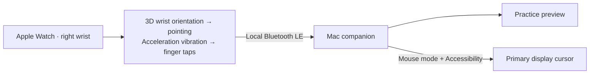

<div align="center">

# Apple-Watch-Cursor

**Your wrist moves the cursor. Your fingers do the clicking.**

A native Apple Watch + Mac experiment for pointing with your right wrist,
clicking with an index-finger-to-thumb tap, and switching mouse mode with a double tap.

[Setup](#setup) · [Calibration](#calibration) · [Controls](#controls) · [Troubleshooting](docs/TROUBLESHOOTING.md) · [Developer preview](https://github.com/intelc/Apple-Watch-Cursor/releases)


[](LICENSE)

</div>

> **Developer preview:** tested on an Apple Watch Series 10. Calibration, mouse movement, single clicks, double-tap mode switching and automatic reconnect work on that setup. **Watch display dimming can interrupt movement; waking the display restores it.** This version is best for short, awake-display sessions.

## How it works



The Watch connects directly to the Mac. There is no cloud service, camera, microphone or iPhone companion app. A paired iPhone can be needed to set up the Watch development connection.

## Setup

### What you need

| Requirement | Details |
| --- | --- |
| Mac | macOS 14 or later, Bluetooth enabled |
| Apple Watch | watchOS 10 or later, worn snugly on your **right wrist**; physically tested on Series 10 |
| Xcode | Full Xcode with SDK/device support for your Watch; verified build environment: Xcode 27.1 |
| Signing | Your Apple account in Xcode, a development team, and Developer Mode on the Watch |
| Time | A source build, two short calibrations, and a preview test |

Deployment targets describe build compatibility, not a guarantee of finger-tap accuracy on every Watch model. Recognition needs a sufficiently fast raw accelerometer stream; the app requests 100 Hz and rejects a sustained rate below 65 Hz.

### 1. Build and install

The **recommended route is Xcode for both apps**. The release includes source and a Mac developer binary; it does not include a generally installable Watch binary, App Store/TestFlight distribution, or a notarized Mac installer.

```sh
git clone https://github.com/intelc/Apple-Watch-Cursor.git
cd Apple-Watch-Cursor
open AppleWatchCursor.xcodeproj
```

1. In Xcode, choose **AppleWatchCursorMac → My Mac**. Build and run. Allow Bluetooth when prompted.
2. Choose the **AppleWatchCursorWatch** target and open **Signing & Capabilities**. Select your development team and automatic signing. If Xcode cannot register the existing identifiers, choose your own unique bundle identifiers for both targets.
3. Choose your **physical Apple Watch** as the run destination. Keep it awake and unlocked. Connect its paired iPhone to the Mac if Xcode needs it for device discovery, enable Developer Mode when requested, then build and run.
4. Allow Watch motion and Bluetooth permissions when prompted. A simulator cannot verify finger taps or real wrist control.

The Xcode project is checked in; XcodeGen is optional unless you edit `project.yml`. See [development and packaging](docs/DEVELOPMENT.md) for command-line builds and identifier configuration.

**Mac download option:** the [preview release](https://github.com/intelc/Apple-Watch-Cursor/releases) has an ad hoc signed, unnotarized universal Mac ZIP. Extract it and move the app to Applications. macOS may block a downloaded developer build; building locally through Xcode is the supported first-run path. If you choose to allow the downloaded build, follow [Apple’s guidance for opening an app from an unidentified developer](https://support.apple.com/guide/mac-help/open-a-mac-app-from-an-unknown-developer-mh40616/mac). This Mac download still needs the Watch app built with your own signing.

### 2. Connect once

Open **Apple-Watch-Cursor** on both devices. Bluetooth starts automatically on Mac. On first connection, click **Trust this Watch** on Mac. No pairing code is required.

Success looks like **Watch connected** on Mac. The Watch remembers its preferred Mac and reconnects automatically after a real connection loss. Mouse input stays off after reconnecting until you deliberately turn it on.

### 3. Grant cursor access

Use **Allow Accessibility…** in the Mac app, then enable the app in **System Settings → Privacy & Security → Accessibility**. Bluetooth connects the devices; Accessibility permits cursor movement and clicks. Practice feedback works without Accessibility.

## Calibration

There are two separate calibrations: one learns your finger tap; the other learns how your arm movement maps to the screen. Keep the Watch display awake throughout both.

### Teach your finger tap · Watch

1. Wear the band snugly on your right wrist. Open **Calibrate finger taps → Begin calibration**.
2. Hold your wrist still at **READY**.
3. Tap your index finger against your thumb once at each of the **six numbered cues**.
4. Wait for the saved profile. A failed recalibration keeps the previous working profile.

The 12-second recording stays on the Watch. This is an experimental vibration detector, so check both missed taps and accidental detections in Practice.

### Teach your pointing directions · Mac

Click **Calibrate pointing…** on Mac and follow the animation from **your perspective**:

| Step | Movement |
| --- | --- |
| 1 | Top → bottom |
| 2 | Bottom → top |
| 3 | Left → right |
| 4 | Right → left |

**Watch the demonstration → use the setup countdown to reach the starting end → hold still → wait for green “GO — MOVE NOW” → sweep → hold briefly at the end.**

A check mark confirms each detected sweep, then the next step starts automatically. No Return key or capture button is needed. Use your comfortable **elbow-centered arc**, including for horizontal movement. The calibration uses full 3D rotation; you do not need a straight line in space.

After four valid sweeps, the mapping saves automatically and the dialog shows **Ready**. Click **Done**, settle into a comfortable neutral pose, and wait for **Mouse standby** on the Watch. **You are ready to go.** A double finger tap enters mouse mode.

Calibration learns direction and range, then resets Flip X, Flip Y and Y sensitivity to neutral. Recenter changes the neutral pose without repeating calibration. Cancelled or failed pointing calibration preserves the previous mapping.

## Controls

| Action | Result |
| --- | --- |
| Move wrist/forearm | Move the cursor on the **primary Mac display** |
| Index finger → thumb, once | Left click after a brief decision delay |
| Two finger taps, about half a second apart | Enter or exit mouse mode; the pair produces no clicks |
| **Recenter** on Watch | Hold still briefly to set neutral and center the pointer |
| **Pause** on Watch, Mac, or Mac menu bar | Stop control; Watch Pause also stops its sensors |
| **Arm mouse gestures** on Watch | Resume after manually pausing |
| Escape with the Mac window focused | Pause control |
| **Practice in preview** on Mac | Try movement and tap feedback without posting mouse events |

Start with Practice. Single taps should flash the preview dot **red** and increase the received-tap counter, even while mouse control is off. Then turn Practice off and double tap to enter live mouse mode. Hold still briefly while the Watch finds center, and try a harmless target.

A single click waits about half a second to distinguish it from a mode-changing double tap. The click uses the target held at the original tap. There is currently no drag, scrolling, right click, or system double-click gesture.

## Known limits

- **Display dimming is the main runtime limitation.** Continuous wrist-down/background control is unresolved. Keeping the app frontmost longer does not guarantee continued sensor delivery. See [display and connection troubleshooting](docs/TROUBLESHOOTING.md).
- Rotation drives pointing. Pure translation while keeping the Watch orientation fixed is not tracked like an optical mouse. Acceleration is available and is used for tap vibration detection.
- Other hand vibrations can resemble a tap. Accuracy across people, false-click frequency, latency and battery cost have not been quantified. A 10/10 live tap check on one setup is not an accuracy benchmark.
- Only the primary display is controlled. Left-wrist use and other Watch models have not been physically validated.
- Device trust is a prototype. The protocol is not audited for hostile Bluetooth peers; see [security notes](SECURITY.md).

## Privacy and permissions

All runtime communication is local Bluetooth LE. There is no telemetry or internet backend. The apps do not request screen recording, camera or microphone access.

- Watch motion permission supplies rotation and acceleration. Six-tap calibration stores a short raw motion recording in the Watch app’s Documents folder.
- Device trust, calibration and preferences stay in local app storage.
- Local connection journals keep at most 100 events. They contain state/errors, aggregate frame counts, tap outcomes and sweep geometry summaries, not session tokens or raw motion samples.
- The Mac journal is at `~/Library/Application Support/Apple-Watch-Cursor/connection-events.json`; the Watch journal is in its app Documents folder.

See [troubleshooting and removal](docs/TROUBLESHOOTING.md) for reset and uninstall instructions. Never attach personal sensor recordings or complete device diagnostics to a public issue without reviewing them.

## Development

```sh
swift test
```

The shared Swift package has **70 tests** for motion mapping, tap processing, calibration, Bluetooth frames, stale-input handling and gesture switching. Native app builds and hardware checks are separate; see [verification](docs/BUILD-VALIDATION.md) and the [hardware evaluation plan](docs/HARDWARE-VALIDATION.md).

| Folder | Purpose |
| --- | --- |
| `Sources/AppleWatchCursorCore` | Signal processing, quaternion calibration, wire format and input gates |
| `Watch` | SwiftUI controls, Core Motion sampling, Bluetooth central |
| `Mac` | SwiftUI companion, Bluetooth peripheral, preview and cursor events |
| `Tests/AppleWatchCursorCoreTests` | Shared logic regression tests |
| `Tools/TapReplay` | Local calibration-recording replay |
| `scripts` | Local build and developer preview packaging |

Read [DEVELOPMENT.md](docs/DEVELOPMENT.md) before changing signing or packaging. The existing bundle identifiers are intentionally retained from the prototype so installed users keep their calibration and trust settings.

## Feedback and license

[Open an issue](https://github.com/intelc/Apple-Watch-Cursor/issues) with your Watch model, OS versions, app version, calibration step and observed behavior. For sensitive security reports, use the [security policy](SECURITY.md). Pull requests are welcome; describe the behavior change and include relevant test or device evidence.

[MIT licensed](LICENSE). Independent project; not affiliated with or endorsed by Apple.
